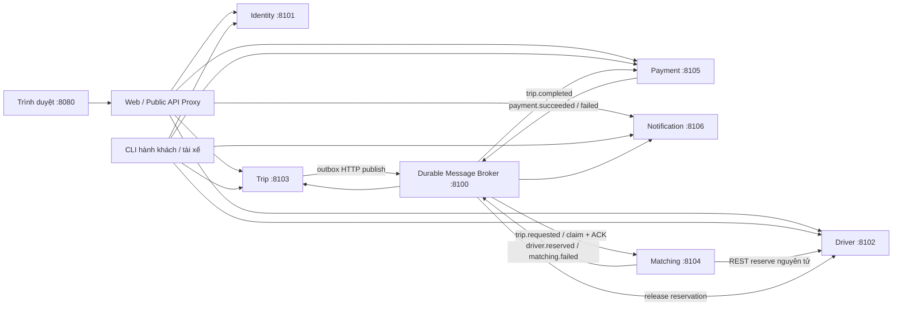

# DS03 — Hệ thống gọi xe microservices mô phỏng Grab/Uber

Triển khai theo mục 4, 7, 9–13 của **COURSE PROJECT SPECIFICATION.pdf**. Có **6 microservice nghiệp vụ**, **1 message broker bền vững**, giao tiếp HTTP/REST và hàng đợi bất đồng bộ. Mỗi tiến trình sở hữu một SQLite riêng; không dịch vụ nào đọc database của dịch vụ khác.

Đây là prototype phục vụ học phần, có **giao diện web tiếng Việt cho hành khách và tài xế**, kèm CLI. Thanh toán và tọa độ được mô phỏng, không gọi cổng thanh toán hay bản đồ thương mại. Message broker tự triển khai để có thể kiểm chứng trực tiếp enqueue, lease, ACK, retry và DLQ; không cần cài RabbitMQ hoặc thư viện Python bên ngoài.

## Mở ứng dụng web — bắt đầu tại đây

Chạy một lệnh trong terminal tại thư mục dự án:

```powershell
python scripts/start.py --open
```

Ứng dụng tự tạo `.env` nếu chưa có, khởi động các dịch vụ còn thiếu và mở **http://127.0.0.1:8080** trên trình duyệt. Giữ terminal này mở. Nếu backend đã chạy ở terminal khác, launcher dùng lại các dịch vụ đó. `Ctrl+C` chỉ dừng các tiến trình do launcher vừa tạo, không dừng dịch vụ đã có trước.

Để xem ngay một chuyến xe trực quan:

1. Mở **http://127.0.0.1:8080**, nhấn **Chuẩn bị demo**. Hệ thống tạo hai tài khoản thật và đưa tài xế vào trạng thái nhận chuyến.
2. Ở vai trò **Hành khách**, chọn điểm đón/đến rồi nhấn **Đặt xe ngay**.
3. Chuyển sang **Tài xế** bằng nút phía trên. Nhấn **Chấp nhận chuyến → Đã đón khách · Bắt đầu → Hoàn thành chuyến**.
4. Chuyển lại **Hành khách**, xem trạng thái hoàn tất, **Lịch sử chuyến**, **Thanh toán** và **Thông báo**.

Cũng có thể nhấn mũi tên ở thẻ **Xem một chuyến đi trọn vẹn** để tự động chạy cả luồng, với tiến độ từng bước hiển thị trên trang. Demo này gọi API thật, không dùng dữ liệu kết quả viết sẵn.

Bạn có thể tự đăng ký tài khoản với hai vai trò hoặc mở hai tab/cửa sổ cho hai người dùng độc lập. Tài xế phải **Bắt đầu nhận chuyến**, ở gần điểm đón và xác nhận đề nghị thì hành trình mới tiếp tục. Nếu không có tài xế, yêu cầu sẽ kết thúc ở trạng thái đã hủy.

Web dùng sơ đồ SVG minh họa tương ứng tọa độ; chưa dùng bản đồ đường bộ, chỉ đường hoặc ETA thực. Giá, ghép tài xế, vòng đời, thanh toán và thông báo do các dịch vụ xử lý. Tài liệu giao diện: [docs/web.md](docs/web.md).

## Kiến trúc



| Thành phần | Dữ liệu sở hữu | Trách nhiệm |
|---|---|---|
| Identity | users, salt, password hash | Đăng ký/đăng nhập, hai vai trò, token có chữ ký |
| Driver | drivers, reservations | Vị trí, hiện diện, giữ/giải phóng tài xế nguyên tử |
| Trip | trips, requests | Vòng đời, fare VND, version, idempotency, deadline Saga |
| Matching | matches | Chọn tài xế qua REST tới Driver, phát kết quả bất đồng bộ |
| Payment | payments | Sổ thanh toán mô phỏng, tối đa một bản ghi/chuyến |
| Notification | notifications | Thông báo riêng cho hành khách và tài xế |
| Broker | events, deliveries | Fan-out queue, lưu bền, lease/ACK, retry, DLQ, redrive |

Mỗi dịch vụ còn có `inbox` và `outbox` cục bộ. UUID xác định user, trip và event; tên dịch vụ và URL môi trường là cơ chế discovery. Docker Compose dùng DNS tên service. Không có API Gateway và không tính broker vào số microservice nghiệp vụ.

## Chạy backend và CLI riêng trên Windows / Linux / macOS

Yêu cầu: **Python 3.11+** (đã kiểm thử bằng Python 3.13), các cổng 8100–8106 trống. Không cần `pip install`.

```powershell
python scripts/configure.py
python scripts/cluster.py
```

Giữ terminal này mở. Mở terminal thứ hai trong thư mục dự án:

```powershell
python scripts/client.py status
python scripts/client.py register --username passenger01 --role passenger
python scripts/client.py register --username driver01 --role driver
```

Nhập mật khẩu tối thiểu 10 ký tự tại prompt. Đầu ra đăng ký chứa `id`, `role`, `token`; giữ token riêng. Đăng nhập lại bằng `python scripts/client.py login --username passenger01`.

Ví dụ PowerShell, thay các chuỗi trong dấu `<...>` bằng giá trị thực:

```powershell
$p = '<TOKEN_HANH_KHACH>'
$d = '<TOKEN_TAI_XE>'
python scripts/client.py driver --token $d --location 10.7769 106.7009 --status available
python scripts/client.py request --token $p --location 10.7769 106.7009 --destination 10.7900 106.7200 --key booking-demo-0001
python scripts/client.py trips --token $p
python scripts/client.py trips --token $d
```

Đợi `state=offered`. Ghi lại `id` chuyến và `version` từ kết quả mới nhất. Mỗi hành động thành công tăng version lên 1:

```powershell
$trip = '<TRIP_ID>'
python scripts/client.py accept --token $d --trip-id $trip --version 2
python scripts/client.py start --token $d --trip-id $trip --version 3
python scripts/client.py complete --token $d --trip-id $trip --version 4
python scripts/client.py trip --token $p --trip-id $trip
python scripts/client.py payments --token $p
python scripts/client.py notifications --token $p
python scripts/client.py notifications --token $d
```

Version ví dụ trên áp dụng khi chưa có thao tác khác. Nếu gặp 409, đọc lại chuyến và đối chiếu trạng thái. Gửi lại yêu cầu đặt xe với **cùng key và cùng payload** trả lại cùng chuyến. Dùng key mới cho lần đặt mới. Một hành khách chỉ có một chuyến đang hoạt động. Có thể dùng `reject` bằng tài xế hoặc `cancel` bằng hành khách; đều phải gửi version hiện tại. Tài xế cập nhật tọa độ khi đang có chuyến bằng `driver --status busy`; không thể tự chuyển sang available để nhận thêm chuyến.

## Khởi động độc lập từng dịch vụ

`cluster.py` tạo **7 tiến trình OS** và ghi PID, không gom các dịch vụ vào một tiến trình. Có thể chạy từng dịch vụ trong terminal riêng; launcher tự đọc `.env`:

```powershell
python scripts/cluster.py --services broker
python scripts/cluster.py --services identity
python scripts/cluster.py --services driver
python scripts/cluster.py --services trip
python scripts/cluster.py --services matching
python scripts/cluster.py --services payment
python scripts/cluster.py --services notification
```

Các dòng trên dành cho **7 terminal riêng**, không chạy đồng thời với cluster toàn bộ trên cùng cổng. Có thể dùng `python -m src.main trip` khi đã export các biến môi trường. `HOST`, `PORT`, `DATA_DIR` và các `<SERVICE>_URL` cho phép phân phối các dịch vụ trên nhiều máy LAN; chỉ chia sẻ secret qua kênh riêng, cấu hình firewall phù hợp.

## Docker Compose và tái triển khai

Yêu cầu thêm Docker Engine và Docker Compose v2:

```powershell
python scripts/configure.py
docker compose --env-file .env -f deploy/compose.yaml up --build -d
docker compose --env-file .env -f deploy/compose.yaml ps
docker compose --env-file .env -f deploy/compose.yaml logs -f
```

Đã xác nhận build/chạy đủ 7 container và **8/8 ca Docker chọn lọc**, gồm vòng đời, concurrency, kill/restart Payment và Broker, compensation, bảo mật và event dedup. Bằng chứng: `docs/docker-results.json`. Để chạy lại trên project kiểm chứng riêng:

```powershell
docker compose --project-name ds03-validation --env-file .env -f deploy/compose.yaml up --build -d
python scripts/docker_smoke.py --project ds03-validation
docker compose --project-name ds03-validation --env-file .env -f deploy/compose.yaml down
```

Script Docker cố ý kill/start hai dịch vụ của project được chỉ định. Chỉ chạy trên stack demo; không chạy song song hai project cùng publish cổng 8100–8106.

Compose hiện có thêm container `web` tại **http://127.0.0.1:8080**. Mỗi backend có volume riêng; các container dùng user không phải root. Web không có business database. Chỉ publish cổng trên `127.0.0.1`. CLI trên host tiếp tục sử dụng được. Triển khai lại giữ dữ liệu:

```powershell
docker compose --env-file .env -f deploy/compose.yaml down
docker compose --env-file .env -f deploy/compose.yaml up --build -d
```

Bản web đã được kiểm chứng trên stack Docker riêng gồm **8 container healthy**, với **14 kiểm tra bằng Edge thật**: đặt/nhận/hoàn tất chuyến, demo tự động, đăng ký/đăng nhập, hủy, từ chối, payment decline và mobile. Xem `docs/docker-web-results.json`, `docs/browser-results.json` và ảnh `docs/ui-passenger.png`, `docs/ui-driver.png`, `docs/ui-mobile.png`.

Không thêm `-v` vào `down` khi cần giữ dữ liệu. Sao lưu riêng từng volume khi dừng ghi; bảo vệ cả dữ liệu Identity và secret ký token. Không chia sẻ một volume dữ liệu giữa hai business service. SQLite phù hợp một instance ghi cho mỗi dịch vụ; không cấu hình nhiều replica ghi trên cùng file.

## Kiểm thử, thực nghiệm và demo bắt buộc

```powershell
python scripts/test.py
python tests/test_web.py
python scripts/demo.py --pause
```

`tests/test_web.py` chạy thêm 6 bài qua web proxy thật tại cổng 9180: static assets/security headers, chặn API nội bộ, chặn origin lạ, full booking/payment/notification, health aggregate và auth/size limits. Kết quả riêng ở `docs/web-test-results.json`. Kiểm tra trình duyệt tùy chọn: cài Playwright vào `runtime/browser-qa` rồi chạy `node scripts/browser_qa.cjs`; ứng dụng không cần Playwright để chạy.

Bộ kiểm thử chạy 7 tiến trình thật trên **9100–9106**, tự tạo secret và database riêng, tự dừng tiến trình khi kết thúc. Không cần khởi chạy cluster trước. Các file `docs/test-results.json` và `docs/performance.json` được tạo từ lần chạy thực. Logs chi tiết ở `runtime/test-<UUID>/logs/`. Thư mục runtime không được commit vì chứa dữ liệu thử nghiệm.

Demo có 6 cảnh: vòng đời bình thường; hai khách tranh một tài xế; kill/restart Payment; kill/restart Broker; Driver chết dẫn tới retry/DLQ rồi redrive; thanh toán bị từ chối và Saga giải phóng tài xế. `--pause` dừng giữa các cảnh để trình bày. Chạy không có `--pause` để kiểm chứng tự động. [Kịch bản trình bày](docs/demo.md) giải thích bằng chứng cần mở.

Tái hiện lỗi thủ công bằng Compose khi một chuyến `in_progress`:

```powershell
docker compose --env-file .env -f deploy/compose.yaml stop payment
# Trong terminal CLI: complete chuyến bằng token tài xế, version hiện tại.
python scripts/client.py queues
# Chuyến ở awaiting_payment; queue payment còn pending.
docker compose --env-file .env -f deploy/compose.yaml start payment
# Poll trip/payments: chuyến completed, tài xế available.
```

Để chứng minh DLQ: dừng Driver trước khi đặt xe, chờ Matching retry tối đa `MAX_ATTEMPTS`, xem `dead-letters`; khởi động Driver rồi `redrive --queue matching --event-id <EVENT_ID>`. Thực hiện trước deadline `SAGA_TIMEOUT`, hoặc tăng deadline trong `.env` rồi tái tạo container Trip trước buổi demo. Chuyến đã cancelled sẽ giữ nguyên cancelled và giải phóng mọi reservation đến muộn.

## Cơ chế phân tán và bảo mật

- REST đồng bộ: CLI → dịch vụ; Matching → Driver giữ tài xế, timeout 2 giây. Queue bất đồng bộ: business outbox → Broker → consumer claim/process/ACK.
- `BEGIN IMMEDIATE` và điều kiện `active_trip IS NULL` tuần tự hóa giữ tài xế. Unique constraints bảo vệ reservation, request key và payment. Lệnh vòng đời có version để phát hiện xung đột.
- Saga: tạo chuyến → giữ tài xế → chấp nhận/hoàn thành → thanh toán. Hủy/từ chối/hết hạn/thanh toán thất bại phát sự kiện bù giải phóng tài xế; không xóa lịch sử chuyến/ledger.
- Nhất quán mạnh trong mỗi giao dịch SQLite; **eventual consistency** giữa các dịch vụ. Broker giao **at-least-once**, inbox và khóa nghiệp vụ chống lặp tác dụng. Không tuyên bố exactly-once delivery.
- Outbox và trạng thái ghi cùng transaction; broker xác nhận sau commit. Nếu ACK bị mất, publish lại cùng event ID. Consumer ghi inbox và tác dụng cùng transaction, ACK sau commit.
- Broker giữ lease, retry theo backoff tối đa 8 giây, giới hạn số lần delivery, DLQ bền vững và operator redrive. Outbox vẫn thử khi broker offline, không tự bỏ sự kiện. Tombstone chống reserve đến sau cancellation; trạng thái terminal không quay lại offered.
- Driver presence hết hạn sau 300 giây không cập nhật; `/health` và timeout phát hiện dịch vụ offline. Trip ở requested/offered có deadline; các bước đang chạy/đợi thanh toán chờ xử lý tiếp thay vì tự hủy và có thể bỏ mất khoản thu.
- Password PBKDF2-HMAC-SHA256, salt ngẫu nhiên, 200.000 vòng; HMAC token có hạn; kiểm tra role và ownership; service key cho internal API và broker; body tối đa 64 KiB; kiểm tra tọa độ và kiểu dữ liệu; SQL tham số hóa.
- Log JSON có node, timestamp UTC, event, correlation_id, result. Không log password/token/body. Cùng correlation ID được giữ từ tạo chuyến qua REST nội bộ và toàn bộ sự kiện Saga.

TLS chưa cấu hình; secret dịch vụ dùng chung trong một miền tin cậy, token chưa có revoke, chưa rate-limit, broker một nút, chưa tự phục hồi mất đĩa. Đây là giới hạn prototype, không phải cấu hình vận hành thực tế. Chi tiết: [thiết kế và API](docs/architecture.md), [ma trận yêu cầu](docs/requirements-matrix.md), [báo cáo](docs/report.pdf), [slides](docs/slides.pdf).

## Bàn giao học phần

Các thư mục yêu cầu đã được tổ chức: `src/`, `deploy/`, `tests/`, `scripts/`, `docs/`, `.env.example` và README này. Nội dung trích từ PDF đề bài nằm tại `docs/assignment.txt`; dự án không có thư viện pip bắt buộc.

Phải điền [thông tin nhóm/phân công](docs/team.md) bằng dữ liệu thật trước khi nộp và cập nhật trang bìa báo cáo qua `scripts/build_docs.py`. Không tự tạo lịch sử đóng góp của thành viên. Mỗi thành viên cần commit phần việc và hiểu cơ chế mình trình bày.

Sau khi nhóm review và kiểm thử, tạo repo GitHub, đẩy các commit thật, cấp quyền giảng viên nếu private, rồi tạo tag/release cuối (ví dụ `v1.0.0`). Chưa có repo hoặc tài khoản được chỉ định nên dự án không tự publish lên GitHub. Hướng dẫn cụ thể ở [checklist bàn giao](docs/submission.md).

Nguồn tham khảo thiết kế: [Saga](https://microservices.io/patterns/data/saga.html), [Transactional Outbox](https://microservices.io/patterns/data/transactional-outbox.html), [Idempotent Consumer](https://microservices.io/patterns/communication-style/idempotent-consumer.html), [SQLite isolation](https://www.sqlite.org/isolation.html), [Python HTTP server](https://docs.python.org/3/library/http.server.html). Các nguồn được diễn giải cho triển khai này; không sao chép một sản phẩm có sẵn. Có sử dụng AI hỗ trợ tạo mã và tài liệu; nhóm cần kiểm chứng, hiểu và chịu trách nhiệm theo mục 13 của đề.
