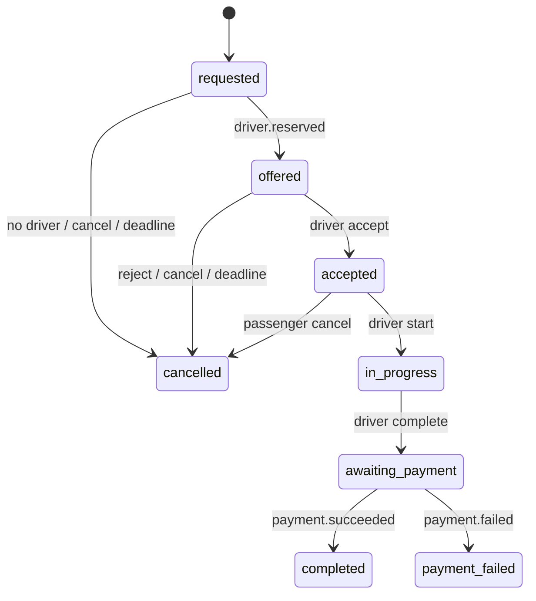

# Thiết kế giao thức, dữ liệu và API

**Cập nhật kiến trúc:** đã bổ sung Pricing :8107, Observability :8108, circuit breaker và parent-child tracing. Hiện có 7 business service, 9 backend + web Gateway. API mới: Pricing `POST /quote` (user token), `POST /internal/quote`; Driver `POST /internal/supply`; Trip `POST /internal/demand`; mọi backend `GET /internal/metrics` (service key); collector `/records`, `/logs`, `/traces`, `/traces/{id}`, `/instances` (service key). Gateway `/api/operations/*` yêu cầu OPERATIONS_KEY. Xem [advanced.md](advanced.md) và [ds03-audit.md](ds03-audit.md) cho phạm vi/bằng chứng mới; các đoạn baseline bên dưới cần đọc cùng cập nhật này.

## Ranh giới triển khai

`python -m src.main <name>` chạy đúng một dịch vụ, bind một cổng HTTP và mở đúng một database tại `$DATA_DIR/<name>/state.db`. `scripts/cluster.py` chỉ là trình khởi chạy tiến trình, không thực hiện nghiệp vụ và không dùng file để truyền thông giữa các service. Mỗi container mount volume riêng; SQLite không phải database dùng chung.

Identity, Driver, Trip, Matching, Payment và Notification là 6 business service. Broker là hạ tầng. Pricing nằm trong Trip; đề chỉ yêu cầu ít nhất 4 dịch vụ nghiệp vụ, không bắt buộc Pricing độc lập. Giao diện web ở cổng 8080 hỗ trợ đầy đủ hành khách/tài xế, sơ đồ vị trí, lịch sử, thanh toán và thông báo. CLI vẫn dùng độc lập được. Web proxy là thành phần thứ 8, không được tính vào 6 business service; không sở hữu hoặc truy cập business database. Chi tiết tại `docs/web.md`.

## Naming, discovery, hiện diện

Service ID cố định: `identity`, `driver`, `trip`, `matching`, `payment`, `notification`, `broker`. Resource ID và event ID: UUID. Service URL lấy từ môi trường; Compose dùng DNS của network `ds03`. Đây là discovery qua cấu hình/DNS, không có registry động. `GET /health` trả `{service,status}` để kiểm tra tiến trình và kết nối database của chính nó. Health không cam kết cả chuỗi phụ thuộc khỏe.

Driver có `updated`; Matching chỉ chọn driver available có cập nhật trong 300 giây và cách pickup không quá 20 km. Tài xế gửi lại trạng thái/vị trí trước khi lease hiện diện hết hạn. Khi busy, gửi status busy để cập nhật vị trí mà không xóa active_trip. Service offline được nhận ra khi HTTP timeout hoặc kết nối bị từ chối; worker ghi retry và queue giữ sự kiện. Không có đồng bộ đồng hồ Lamport; deadline và lease dùng thời gian thực, cần các máy có đồng hồ đồng bộ khi triển khai đa máy. Mọi deadline broker được tính bởi chính broker.

## API công khai

Mặc định `Content-Type: application/json`; body ≤ 65.536 byte. Các API tài nguyên cần `Authorization: Bearer <token>`. Mọi response có `X-Correlation-ID`. Có thể gửi correlation ID theo định dạng `[A-Za-z0-9._-]{1,128}`; ID sai được thay bằng UUID.

| Dịch vụ | Method / path | Input / quyền | Kết quả |
|---|---|---|---|
| Identity | POST /register | username 3–64; password 10–128; role passenger/driver | id, username, role, token |
| Identity | POST /login | username, password | cùng định dạng đăng ký |
| Driver | POST /drivers/me | driver; location `[lat,lon]`; status available/offline/busy | cập nhật profile |
| Driver | GET /drivers/me | driver sở hữu token | location, status, active_trip, updated |
| Trip | POST /trips | passenger; pickup, destination, payment_mode; Idempotency-Key 8–128 | chuyến và version |
| Trip | GET /trips | passenger/driver | tối đa 100 chuyến của chính user |
| Trip | GET /trips/{id} | chủ chuyến hoặc tài xế được gán | trạng thái mới nhất |
| Trip | POST /trips/{id}/accept | tài xế được gán; `{version}` | offered → accepted |
| Trip | POST /trips/{id}/reject | tài xế được gán; `{version}` | offered → cancelled |
| Trip | POST /trips/{id}/start | tài xế được gán; `{version}` | accepted → in_progress |
| Trip | POST /trips/{id}/complete | tài xế được gán; `{version}` | in_progress → awaiting_payment |
| Trip | POST /trips/{id}/cancel | passenger chủ chuyến; `{version}` | requested/offered/accepted → cancelled |
| Payment | GET /payments | passenger/driver | tối đa 100 payment liên quan user |
| Notification | GET /notifications | passenger/driver | tối đa 100 thông báo của user |
| Mọi service | GET /health | public, không lộ secret | service, status |

HTTP thành công dùng 200. Lỗi dùng `{"error":"..."}`: 400 sai dữ liệu; 401 thiếu/sai/hết hạn token hoặc credentials; 403 sai quyền; 404 không tồn tại; 409 xung đột trạng thái/version/key; 413 body quá lớn; 503 dependency offline. CLI in JSON và thoát code 1 khi lỗi API. Không tự retry mù lệnh vòng đời: đọc lại trạng thái sau timeout trước khi quyết định thao tác tiếp.

## API nội bộ và vận hành

Tất cả yêu cầu trong bảng này cần `X-Service-Key`. Token user không thay thế được key này.

| Service | Method / path | Mục đích |
|---|---|---|
| Driver | POST /internal/reserve | `{trip_id,pickup}` → `{driver_id: UUID hoặc null}`; idempotent theo trip |
| Broker | POST /events | enqueue envelope, dedup event ID; cùng ID khác nội dung trả 409 |
| Broker | POST /queues/{name}/claim | trả `{event,receipt}` hoặc `{event:null}` |
| Broker | POST /queues/{name}/ack | `{event_id,receipt}`; chỉ receipt còn lease hợp lệ |
| Broker | POST /queues/{name}/nack | `{event_id,receipt,error}`; backoff hoặc DLQ |
| Broker | POST /queues/{name}/redrive | `{event_id}`; chỉ message dead, reset attempts |
| Broker | GET /queues/{name}/{event_id} | trạng thái một delivery phục vụ kiểm chứng |
| Broker | GET /stats | số message theo queue và state |
| Broker | GET /dead-letters | tối đa 100 dead delivery và lỗi gần nhất |

Broker giao qua HTTP pull; REST là transport của thao tác queue, không biến luồng nghiệp vụ bất đồng bộ thành lời gọi trực tiếp: producer chỉ đợi enqueue bền vững, consumer có thể dừng hoàn toàn rồi nhận sau. Broker có DB và tiến trình độc lập, lưu mỗi subscriber một delivery; không phải hàng đợi Python trong RAM.

## Định dạng message

```json
{
  "id": "UUID-event",
  "topic": "trip.requested",
  "producer": "trip",
  "timestamp": 1793680000.0,
  "correlation_id": "UUID-saga",
  "payload": {
    "trip_id": "UUID-trip",
    "passenger_id": "UUID-passenger",
    "driver_id": null,
    "pickup": [10.7769, 106.7009],
    "destination": [10.79, 106.72],
    "fare": 32214,
    "payment_mode": "success",
    "version": 1
  }
}
```

Ví dụ chỉ mô tả cấu trúc; số fare trong response thực được tính lại. Payload production có thêm trường của Trip, gồm state, created, updated, deadline và id. Notification là hộp thư trong ứng dụng được user đọc qua REST; chưa có SMS/email/push bên ngoài.

| Topic | Producer | Subscribers |
|---|---|---|
| trip.requested | Trip | Matching, Notification |
| driver.reserved | Matching | Trip, Notification |
| matching.failed | Matching | Trip, Notification |
| trip.accepted, trip.started | Trip | Notification |
| trip.completed | Trip | Payment, Notification |
| trip.cancelled | Trip | Driver, Notification |
| payment.succeeded, payment.failed | Payment | Trip, Driver, Notification |

## Trạng thái và tính nhất quán



Mỗi transition tăng version và ghi outbox cùng transaction. API `complete` chưa bảo đảm đã thanh toán; phải poll cho đến completed/payment_failed. Khi Payment offline, chuyến giữ awaiting_payment, driver giữ busy; restart Payment tiếp tục xử lý message.

Invariant: một driver có tối đa một active_trip; một trip có tối đa một reservation; một passenger có tối đa một chuyến chưa terminal; một trip có tối đa một payment; terminal trip không trở lại offered. Tài xế giữ busy trong lúc chờ thanh toán, do đó không có hai chuyến active trên cùng driver dù các service nhìn thấy trạng thái trễ.

Outbox publish theo rowid thực tế của bảng; queue claim theo thứ tự enqueue. Retry có thể gây đảo thứ tự; không dựa vào FIFO tuyệt đối. Reservation tombstone chống release trước reserve. Trip bỏ qua late matching để không hồi sinh chuyến và phát compensation mới. Notification sắp theo timestamp và event ID; đây là lịch sử sự kiện, không là nguồn sự thật của state. Version phục vụ phát hiện xung đột lệnh và giải thích trạng thái, không phải vector clock.

## Saga và điểm lỗi

Saga theo choreography: Trip phát requested; Matching gọi Driver để giữ; Trip nhận kết quả; tài xế thực hiện vòng đời; Payment nhận completed và phát succeeded/failed. Mỗi bước có commit cục bộ. Không có distributed ACID transaction, không dùng 2PC.

Nếu driver reject, passenger cancel, không tìm thấy driver hoặc quá hạn requested/offered: Trip terminal cancelled, phát trip.cancelled để Driver giải phóng. Nếu payment bị từ chối: ledger declined được giữ làm bằng chứng, Trip terminal payment_failed và Driver giải phóng. Chuyến vật lý đã hoàn thành không thể hoàn tác; compensation chỉ đóng luồng tài nguyên/thanh toán mô phỏng, chưa xử lý công nợ thực tế.

Nếu Matching chết sau khi Driver đã commit reserve nhưng trước commit inbox/outbox, message chưa ACK được giao lại. REST reserve cùng trip_id trả cùng driver; sau đó kết quả được ghi. Nếu Trip hết deadline trong thời gian đó, cancellation tombstone/release và xử lý late result bảo đảm không để busy vĩnh viễn khi queue cuối cùng được khôi phục hoặc operator redrive. Nếu đĩa hỏng hoặc DLQ bị bỏ quên thì không có bảo đảm hoàn tất.

Consumer commit dữ liệu và inbox rồi ACK. Crash trước commit: giao lại và làm lại. Crash sau commit trước ACK: inbox ngăn lặp tác dụng. Publisher crash sau broker commit trước đánh dấu outbox: publish lại cùng event ID, broker không tạo delivery mới. Payment còn unique trip_id để chống trùng ngữ nghĩa dù có event ID khác.

## Bảo mật và giới hạn triển khai

Secret trong `.env`, không commit; `.env.example` chỉ có tên biến. Username chuẩn hóa chữ thường, giới hạn ký tự; role admin không tồn tại. Hash password có salt riêng; HMAC token TTL mặc định 3600 giây. API chỉ tra tài nguyên theo user token, không tin passenger_id/driver_id từ client. Fare tính ở server, mode decline là công tắc mô phỏng được công khai cho demo.

Các service tin cậy nhau qua một key dùng chung; chưa có mTLS hoặc ACL từng queue/producer theo danh tính mật mã riêng. Broker xác nhận producer/topic hợp lệ về cấu trúc nhưng key nội bộ bị lộ sẽ cho phép giả mạo producer. `http.server` của Python dùng cho prototype, chưa phù hợp phục vụ Internet trực tiếp. Cần TLS/reverse proxy, rate limit, token rotation/revocation, secret manager và audit trước vận hành thật.

SPOF: Broker và mỗi service đều một instance; persistent DB chịu được crash tiến trình, không chịu được mất đĩa/máy. SQLite chỉ một writer mỗi file, hợp demo nhỏ; chưa đo scale nhiều máy hoặc replication. HTTP timeout mặc định 2 giây; worker poll 100–150 ms tạo độ trễ nền. DLQ cần operator kiểm tra và redrive có chủ đích. Không tuyên bố high availability.
